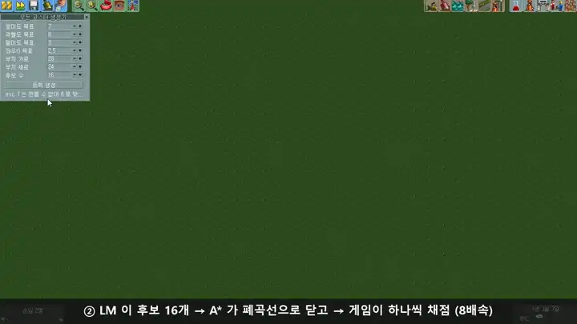
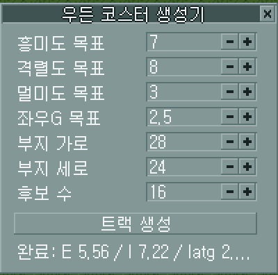
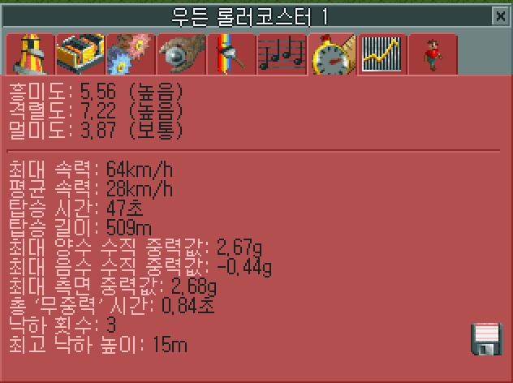
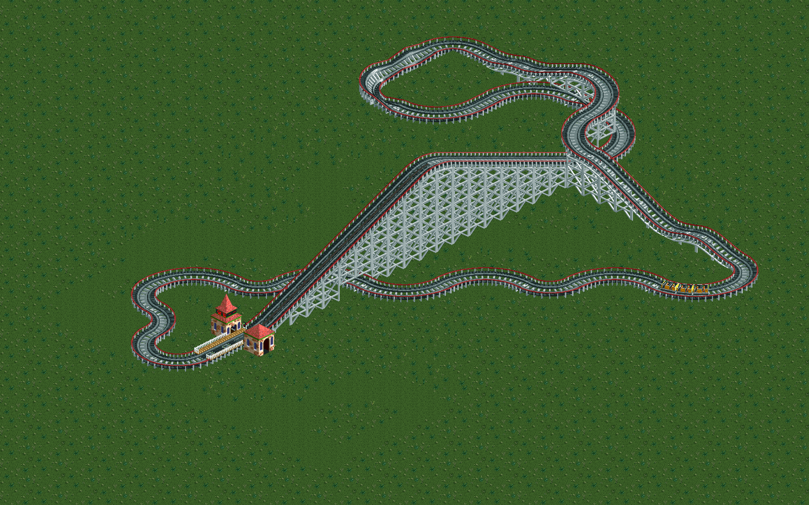
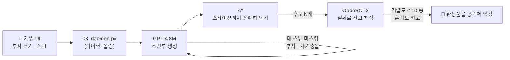
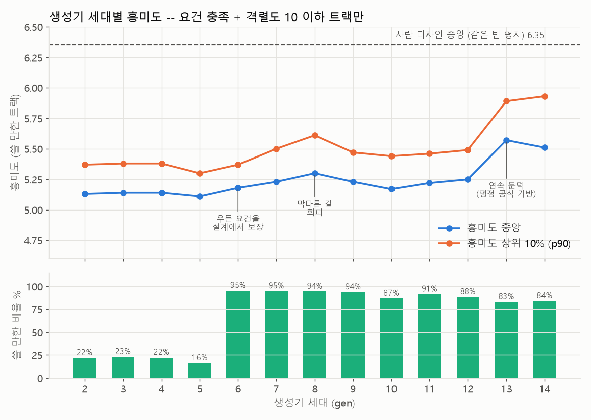

# ilovewoodencoaster 🎢

**OpenRCT2 안에서 버튼 하나로 우든 롤러코스터를 설계해 주는 작은 트랜스포머 + 플러그인.**

> 원하는 크기의 부지에서, 격렬도가 너무 높지 않게 하면서, 흥미도를 최대로.

[](docs/media/demo.mp4)

*게임 안 생성기 창 → LM 후보 16개 → A\* 로 폐곡선 → 게임이 채점 → 최고 후보를 남기고 실제로 달린다.
이미지를 누르면 자막이 들어간 전체 영상(1분, [demo.mp4](docs/media/demo.mp4))이 열린다.*

---

## 한눈에 보기

| | |
|---|---|
|  |  |
| **생성기 창** — 지도 메뉴 → "우든 코스터 생성기". 부지 크기와 목표를 넣고 `트랙 생성` | **게임이 매긴 평점** — 위 영상의 트랙. 흥미 5.56 / 격렬 7.22 / 멀미 3.87, 509m, 낙하 3회 |



*위 데모에서 모델이 지은 코스터 (65조각, 28×24 부지, 후보 13개 중 1등). 리프트 → 첫 낙하 → 연속 둔덕 → 헬릭스 → 스테이션.*

## 어떻게 동작하나



1. **게임을 라벨러로 쓴다.** 절차적 생성기로 트랙을 대량으로 만들고 OpenRCT2 가 흥미/격렬/멀미를 매긴다.
   지금까지 **150,823개**. 사람 디자인은 수천 개뿐이라 이 방법이 아니면 데이터가 없다.
2. **조건부 생성 (Decision Transformer 방식).** 게임이 매긴 평점과 부지 크기를 프리픽스 토큰으로 붙여 학습한다.
   추론 때는 원하는 값을 같은 자리에 넣는다.
3. **기하는 학습시키지 않는다.** 부지 이탈·자기충돌은 매 스텝 시뮬레이터로 마스킹하고,
   폐곡선(x, y, z, 방향, 경사, 뱅크 6개 일치)은 A\* 가 닫는다.
4. **best-of-N.** 후보를 여러 개 지어 보고 "격렬도 10 이하 중 흥미도 최고"를 고른다.

모델과 데이터가 어떻게 만들어지고 어떻게 나아지고 있는지는 **[docs/TRAINING.md](docs/TRAINING.md)** 에 그림과 함께 정리했다.

## 지금 어디까지 왔나



| 지표 | 처음 | 지금 |
|---|---|---|
| 폐곡선 완성 (LM 단독 → A\* 마무리) | 0% | **100%** |
| 부지 준수 (constrained decoding) | 12~20% | **100%** |
| 게임의 배치 거부 | 16.7% | **4.2%** |
| 쓸 만한 트랙 비율 (우든 요건 + 격렬도 ≤ 10) | 16~23% (gen2~5) | **84~95%** (gen6+) |
| 흥미도 중앙 / 상위 10% | 5.13 / 5.37 (gen2) | **5.51 / 5.93** (gen14) |
| 흥미도 최고 | 5.92 | **6.43** |
| 사람 디자인 (같은 빈 평지에서 실측) | | 중앙 6.35 / 최고 7.44 |

가장 최근 도약(gen13~14)은 **OpenRCT2 평점 공식 원문을 읽고** 낙하 횟수와 에어타임을 늘리도록
생성기를 바꾼 결과다. 세대별 기록과 되돌린 시도들은 **[docs/DEVLOG.md](docs/DEVLOG.md)**.

## 빠른 시작

**필요한 것**: OpenRCT2 0.5.0+ (quickjs-ng 스크립팅), RCT2 원본 에셋, Python 3.10+, (학습/추론에) PyTorch + NVIDIA GPU

```bash
pip install -r requirements.txt
```

1. **플러그인 설치** — `plugin/ridecreation-api.js` 를 `Documents/OpenRCT2/plugin/` 에 복사.
   [`markusklock/openrct2-ridecreation-api`](https://github.com/markusklock/openrct2-ridecreation-api) 에
   이 프로젝트의 패치(포트 고정, 실측용 엔드포인트, 생성기 UI)를 얹은 정본이다. 원본으로는 동작하지 않는다.
2. **게임 실행** — `openrct2.com` 으로 실행하고 빈 평지 샌드박스 공원을 연다 (플러그인은 공원 로드 후 시작된다).
3. **데몬 실행**

   ```bash
   python scripts/08_daemon.py --port 8080
   ```

4. 게임에서 **지도 메뉴 → "우든 코스터 생성기"** → 값 조정 → **트랙 생성**.

콘솔에서 바로 돌려볼 수도 있다:

```bash
python scripts/07_bestof.py --width 28 --depth 24 --n 16
```

## 파이프라인 스크립트

| 단계 | 명령 | 하는 일 |
|---|---|---|
| 0 | `python scripts/00_smoke.py` | 게임 연결 확인 |
| 1 | `python scripts/02_hello_coaster.py` | 손으로 짠 코스터 하나 짓고 평점 받기 |
| 2 | `python scripts/01_extract_geometry.py`<br/>`python scripts/14_extract_slopes.py`<br/>`python scripts/09_extract_footprints.py` | 조각 연결 규칙(`geometry.json`)과 실제 점유 타일(`footprints.json`)을 게임에서 실측 |
| 3 | `python scripts/setup_instances.py --n 16`<br/>`python scripts/run_instances.py --n 16`<br/>`python scripts/collect_all.py --n 16 --each 5000 --seed-base 2400 --tag run15` | 인스턴스 16개 병렬 수집 (시간당 약 2,000개) |
| 3 | `python scripts/build_dataset.py --min-gen gen2` | 세대 태깅 + 중복 제거 → `data/dataset.jsonl` |
| 4 | `python scripts/04_train.py` | 조건부 GPT 학습 (RTX 5070 에서 1~2분) |
| 4 | `python scripts/07_bestof.py` | 후보 → A\* → 게임 채점 → 최고 선택 |
| 5 | `python scripts/08_daemon.py` | 게임 UI 요청 처리 |

분석 도구 (게임 없이 돈다):

| 명령 | 하는 일 |
|---|---|
| `python scripts/16_rating_breakdown.py` | 평점 공식 원문으로 흥미도를 항별로 분해 |
| `python scripts/18_gen_profile.py` | 생성기 세대별 특징표 |
| `python scripts/11_human_gap.py` | 사람 디자인과의 구조 차이 |
| `python scripts/19_doc_figures.py` | 문서 그림 다시 그리기 |
| `python scripts/verify_claims.py` | 문서 숫자를 데이터로 대조 |

> **병렬 수집 주의**: 창을 그냥 여러 개 띄우면 Windows 에서는 전부 8080 에 겹쳐 붙어 서로의 트랙을 지운다.
> 반드시 `setup_instances.py` / `run_instances.py` 를 쓸 것. 16개가 최적이다 (16 논리 코어).

## 구조

```
plugin/          게임 안 TCP JSON API + 생성기 UI (ridecreation-api 패치 정본)
rct/             게임 통신 (클라이언트, 환경 래퍼, 조각 상수)
geom/            조각 기하 + 순수 파이썬 시뮬레이터 + A* 플래너
gen/             절차적 트랙 생성기 + 우든 요건 예측기
model/           토크나이저, GPT, constrained decoding, LM+A* 하이브리드, best-of-N
scripts/         단계별 실행·분석 스크립트
docs/            학습 문서, 개발 기록, 미디어
geometry.json    조각 연결 규칙 (게임에서 추출, 676개 조합)
footprints.json  조각이 실제로 점유하는 타일 (게임에서 실측)
```

## 문서

- **[docs/TRAINING.md](docs/TRAINING.md)** — 모델을 어떻게 학습했고 왜 이렇게 설계했는가, 그리고 어떻게 나아지고 있는가 (그림 설명)
- **[docs/DEVLOG.md](docs/DEVLOG.md)** — 버전(생성기 세대) 기록, 실측 메모, 틀렸던 결론과 정정
- **[CLAUDE.md](CLAUDE.md)** — 원본 인수인계 노트. 모든 실측의 근거가 날짜별로 남아 있다

## 라이선스

MIT. 플러그인은 [`markusklock/openrct2-ridecreation-api`](https://github.com/markusklock/openrct2-ridecreation-api) 를 기반으로 한다.
