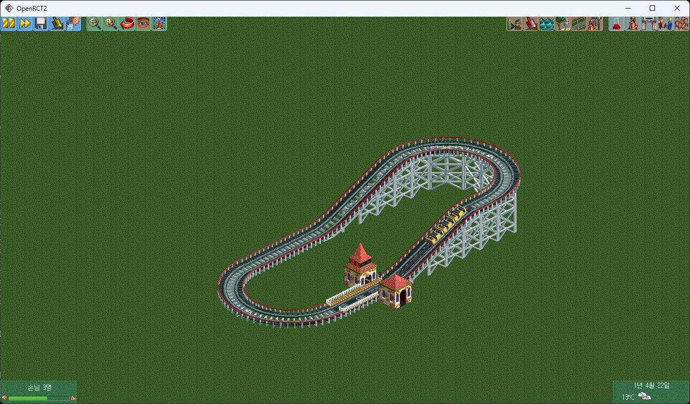

# 개발 기록 (DEVLOG)

버전(생성기 세대) 기록과 그날그날의 실측 메모. 최신이 위.
원본 노트와 모든 숫자의 근거는 [CLAUDE.md](../CLAUDE.md) 에 날짜별로 있다. 이 문서는 그걸 시간순으로 읽기 좋게 정리한 것이다.

- [버전 표](#버전-표)
- [날짜별 기록](#날짜별-기록)
- [틀렸던 결론들](#틀렸던-결론들)
- [작업 메모 (사고 방지용)](#작업-메모-사고-방지용)

---

## 버전 표

데이터 수치는 `python scripts/18_gen_profile.py` 기준 (2026-10-11). "쓸 만한" = 우든 요건 충족 + 격렬도 ≤ 10.

| 세대 | 날짜 | 무엇이 바뀌었나 | 개수 | 쓸 만한 | 흥미 중앙 | p90 | 최고 | 낙하 |
|---|---|---|---:|---:|---:|---:|---:|---:|
| gen1 | 09-05 | 첫 대량 수집. `banked` 플래그가 사실상 무효 | (제외) | | | | | |
| gen2 | 09-05 | `strict_banked` 로 맨턴/뱅크 영역 분리, 리프트 10~13 개방 | 13,956 | 22% | 5.13 | 5.37 | 5.92 | 2 |
| gen3 | 09-05 | 설계 시간 상한 (분포는 gen2 와 같음) | 20,343 | 23% | 5.14 | 5.38 | 6.00 | 3 |
| gen4 | 09-06 | 스테이션 플랫폼 타일을 점유로 반영 (배치 60% → 77%) | 73,175 | 22% | 5.14 | 5.38 | 5.89 | 2 |
| gen5 | 09-13 | 브레이크 어휘 + 실측 footprint + `plan_safe` (배치 거부 17% → 4%) | 33,390 | 16% | 5.11 | 5.30 | 5.73 | 2 |
| gen6 | 09-19 | **우든 요건 4개를 설계 단계에서 보장**, 리프트 하한 6, 낙타등 언덕 | 127 | 95% | 5.18 | 5.37 | 5.65 | 3 |
| gen7 | 09-20 | 언덕 4~9개를 본체 전체에 흩뿌림 | 921 | 95% | 5.23 | 5.50 | 5.98 | 4 |
| gen8 | 09-20 | 워크가 한 수 앞을 봄 (막다른 길 회피), 워크 길이 2배 | 2,026 | 94% | 5.30 | 5.61 | 6.13 | 4 |
| gen9 | 09-20 | 층 바꾸기 `_ramp` — 효과 없음 | 223 | 94% | 5.23 | 5.47 | 5.94 | 4 |
| gen10 | 09-20 | `ztol` 2 → 4 — 오히려 손해, 되돌림 | 128 | 87% | 5.17 | 5.44 | 5.63 | 3 |
| gen11 | 09-20 | 언덕 높이 제한 완화 (나중에 골짜기 왕복 버그의 원인으로 밝혀짐) | 1,178 | 91% | 5.22 | 5.46 | 5.93 | 3 |
| gen12 | 09-20 | 60도 경사 어휘 — 중앙값은 그대로, 꼬리만 조금 | 326 | 88% | 5.25 | 5.49 | 5.93 | 3 |
| gen13 | 09-27 | **평점 공식 기반: 연속 둔덕 9~14개**, 첫 낙하를 지면까지 | 258 | 83% | 5.57 | 5.89 | 6.43 | 8 |
| **gen14** | 09-27 | gen13 + 언덕 여유 8 (골짜기 왕복 수정) | **3,735** | 84% | **5.51** | **5.93** | **6.43** | 6 |

합계 **150,823개** (gen14 대조군 1,037개 포함, gen1 제외).
사람 디자인을 같은 빈 평지에 지어서 잰 값: 흥미 중앙 **6.35**, 최고 **7.44**.

## 날짜별 기록

### 2026-10-11 — 문서 정리, 게임 데모 녹화
- README 를 새로 쓰고 학습 문서([TRAINING.md](TRAINING.md))와 이 개발 기록을 분리했다.
- 게임 안 생성기로 실제 생성 → 채점 → 주행을 녹화했다 (`docs/media/demo.mp4`). 요청 흥미 7 → 도달 가능 값 6 으로 당김,
  후보 16개 중 폐곡선 14개, 13개 지어서 **흥미 5.56 / 격렬 7.22** 선택. 쓰인 모델은 초기 체크포인트(`ckpt.pt`)다.
- 플러그인에 `setView` 엔드포인트 추가 (메인 화면을 타일 좌표로 옮기고 줌/회전). 콘솔의 `set location` 은 단위가 화면 픽셀이라
  트랙 좌표로 못 맞췄다. 녹화 때 열차 좌표(`getRideVehicles`)를 따라가는 추적 카메라로도 쓴다.
- `scripts/19_doc_figures.py`: 문서 그림 재생성.
- 1단계 사진/영상을 `docs/media/stage1.*` 로 옮겼다.

### 2026-09-27 — 평점 공식 원문 확보, 수집 시도의 76% 가 버려지고 있었다
- OpenRCT2 소스(`RideRatings.cpp`, `WoodenRollerCoaster.h`)의 흥미도 공식을 그대로 옮겼다 (`16_rating_breakdown.py`).
  지면 칸 수와 잔차가 공식 계수대로 비례해서 옮김이 맞다는 것도 확인.
- **"길이가 제일 강한 레버"는 착시였다.** 길이 항은 813m 여도 +0.11. 진짜 레버는 낙하 횟수(9회 상한)와 에어타임(6초 상한).
- **골짜기 왕복 버그:** gen11 의 언덕 여유 2 때문에 열차가 언덕을 못 넘고 골짜기에서 영원히 왕복 → 평점 안 나옴 → 30초 후 폐기.
  실패는 레코드를 안 남기고 로그도 덮어써서 안 보였다. 여유 8 로 고치고 설계 단계 검사(`clears_hills`) 추가. 실패 시도 76% → 14%.
- gen13/gen14: 연속 둔덕. 흥미 중앙 5.30 → 5.51, p90 5.60 → 5.93, 최고 6.43, 에어타임 0.78 → 1.83초.
- 실패 설계는 이제 `data/<tag>_<port>.fail.jsonl` 에 남긴다 (진단용, 학습 데이터 아님).

### 2026-09-24 — 사람 흥미도는 7.90 이 아니었다
- TD6 헤더의 평점을 한 칸 밀려 읽고 있었다. "사람 흥미 7.90" 은 격렬도, "사람 격렬 4.65" 는 멀미도였다.
- 스톡 30개를 우리 빈 평지에 그대로 지어서 쟀다 (`15_stock_on_flat.py`). 29개가 길이·낙하 수까지 헤더와 완전히 일치.
  **빈 평지 중앙 6.35 / 최고 7.44.** 원래 공원 대비 환경 몫이 약 0.7, 진짜 트랙 격차는 약 1.2.
- 조각열 시작 오프셋도 한 칸 틀려 있었다 (0xA5 → 0xA3).

### 2026-09-20 — 층 쌓기, 60도, 칸 수: 셋 다 답이 아니었다
- gen7 언덕 흩뿌리기, gen8 막다른 길 회피는 효과가 있었다 (중앙 5.18 → 5.30).
- 층 바꾸기(`_ramp`) 효과 0 — 40개 표본의 착시였고 200개 짝지어 재니 같았다.
- `ztol` 4: 긴 트랙의 배치 거부는 사라지는데 설계 길이가 깎여서 손해.
- 60도 경사 어휘 추가 (`14_extract_slopes.py`): 중앙값 그대로, 에어타임과 꼬리만 조금.
- 열차 칸 수: 기본 편성이 이미 상한, 움직임 최대 0.13.
- 인스턴스 수 실측: **16개가 최적** (16 논리 코어. 25개면 인스턴스당 반토막).

### 2026-09-19 — 데이터의 75% 가 평점 반토막이었다
- 우든 코스터 요건 4개(길이 370m, 최고 낙하 12, 음의 G, 낙하 2회) 중 하나라도 못 채우면 평점이 반으로 깎인다.
  요건 미달 106,103개 중 흥미 4.2 이상은 0개.
- 요건 4개가 시퀀스만으로 예측된다 (`gen/requirements.py`, 낙하 수·최고 낙하 100% 일치). 설계 단계에서 걸렀다 → gen6.
- best-of-N 점수를 "격렬도 > 10 실격, 아니면 흥미도"로 고쳤다.

### 2026-09-13 — 재학습 비교가 틀린 목적함수였다
- 140,868개로 재학습해서 게임 비교를 했는데 점수가 "요청값과의 거리"였다. 흥미도를 5.06 → 5.59 로 올린 모델이
  격렬도가 9.38 로 올랐다는 이유로 감점됐다 (둘 다 10 이하라 후자가 명백히 낫다).
- **프로젝트 목표를 못 박았다: "원하는 크기의 부지에서, 격렬도가 너무 높지 않게 하면서, 흥미도를 최대로."**
- 배치 거부 17% → 4%: 입구/출구 건물 예약, 실측 footprint(`09_extract_footprints.py`), `plan_safe`.
- 격렬도 구멍(4.0~5.0)은 브레이크로도 안 메워졌다 — 그리고 사람도 그 구간에 안 간다.
- 문서 대조 검증 스크립트 `verify_claims.py`, `check_buckets.py`, `10_vocab_coverage.py`.

### 2026-09-12 — 첫 모델 크기 스윕
- 3.2M ~ 37.9M 네 가지. val 은 단조 개선(0.600 → 0.553), 게임 결과는 판별 불가.
- 조건 토큰 8개 중 2개(height, station)가 한 버킷에만 몰려 죽어 있음을 확인 → `SEEN_BUCKETS` 로 추론 때 보정.

### 2026-09-05 ~ 06 — 대량 수집 시작
- 인스턴스 25개 병렬 (Windows `SO_REUSEADDR` 때문에 포트 자동 탐색이 안 돼서 인스턴스별 포트 고정).
- 설계를 파이썬으로 옮기고(A\* 폐곡선) 게임 왕복은 1회로: 트랙당 33초 → 5~10초, 폐곡선 0% → 수십 %.
- 4단계 학습 + constrained decoding + A\* 하이브리드 + best-of-N 이 종단으로 돌았다. 게임 UI 첫 버전.

### 2026-08-26 ~ 27 — 시작
- OpenRCT2 + ridecreation-api 플러그인 연결, 조각 기하 추출(`geometry.json`).
- 손으로 짠 첫 폐곡선 코스터: 흥미 0.27 / 격렬 0.30 / 멀미 0.18.

[1단계 영상](media/stage1.mp4)

## 틀렸던 결론들

나중에 정정된 것들. 같은 실수를 반복하지 않으려고 모아둔다.

| 날짜 | 당시 결론 | 실제 | 어떻게 알았나 |
|---|---|---|---|
| 09-12, 09-13 | 재학습한 모델이 옛 모델보다 나쁘다 | 점수 함수가 목표와 달랐다 | 목표를 다시 쓰고 같은 결과를 재해석 |
| 09-13 | 격렬도 구멍(4~5)을 메워야 한다 | 사람도 안 가는 구간 | 스톡 디자인 분포 확인 |
| 09-13 | 플러그인에 헬릭스/브레이크가 없다 | 이미 놓인다 | 게임에 직접 놓아봄 |
| 09-13 | 헬릭스가 스톡 조각 150회+ | 35회. 나머지는 대각선 | TD6 파서 재작성 |
| 09-19 | 사람은 흥미 7.90, 격렬 4.65 | 7.05 / 7.90 (한 칸 밀려 읽음) | 스톡을 빈 평지에 지어서 실측 |
| 09-20 | 길이가 제일 강한 레버 | 낙하·에어타임이 같이 늘어난 착시 | 평점 공식 원문 |
| 09-20 | 언덕 높이 제한 완화가 진짜 이득 | 열차가 골짜기에 갇혀 시도의 76% 폐기 | 차량 속도 부호를 직접 관찰 |

## 작업 메모 (사고 방지용)

- **수집기를 고치면** `python -m py_compile scripts/03_collect.py` 와 `--help` 를 먼저 돌려볼 것.
  문법 오류를 커밋해서 수집기 16개가 첫 실패에서 전부 죽은 적이 있다.
- **점검 스크립트가 끝났는지 확인하고 수집기를 붙일 것.** 같은 게임에 클라이언트 둘이 붙으면 서로의 트랙을 지운다.
- **`--seed-base` 는 안 쓴 값으로.** 다음은 2400부터 (쓴 목록은 CLAUDE.md).
- **part 파일 이름을 바꾸지 말 것.** 세대 판별의 99% 가 파일 이름 접두사에 의존한다.
- **합칠 때 `cat` 하지 말고 `build_dataset.py`.** `stock_on_flat.jsonl`, `*.fail.jsonl` 은 자동으로 제외된다.
- **어휘를 늘릴 때는 맨 뒤에만 붙일 것.** 중간에 끼우면 기존 체크포인트의 토큰 ID 가 밀린다.
- **한국어 Windows 콘솔(cp949)에서 em-dash 등을 `print()` 하면 스크립트가 죽는다.** 출력은 ASCII 문장부호로.
- **플러그인을 고치면** `plugin/ridecreation-api.js` 가 정본이다. `Documents/OpenRCT2/plugin/` 에 복사하고
  `setup_instances.py --plugin-only --n 16` 으로 인스턴스 사본을 갱신, 떠 있는 인스턴스는 재시작.
- **수집을 더 하면 `verify_claims.py` 가 깨진다** — 문서 숫자를 같이 고칠 것.
