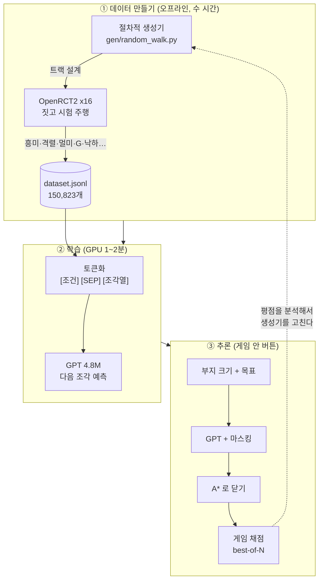
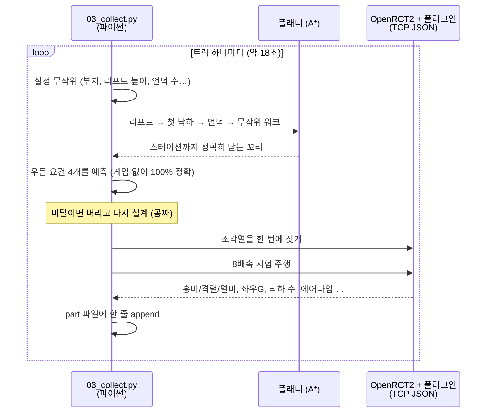
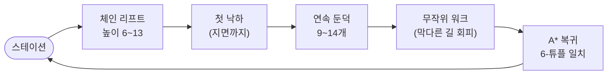
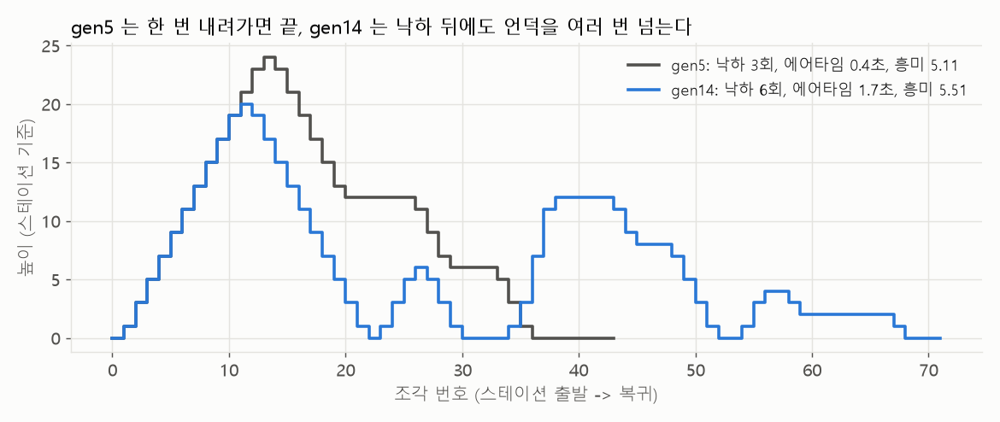
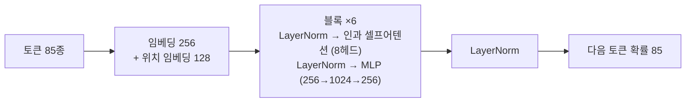
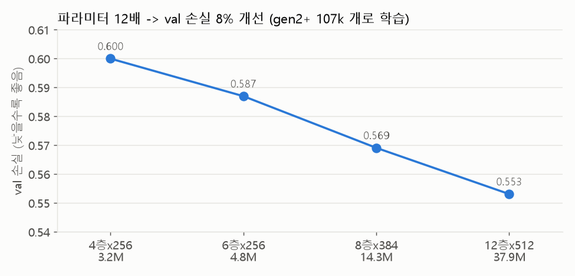
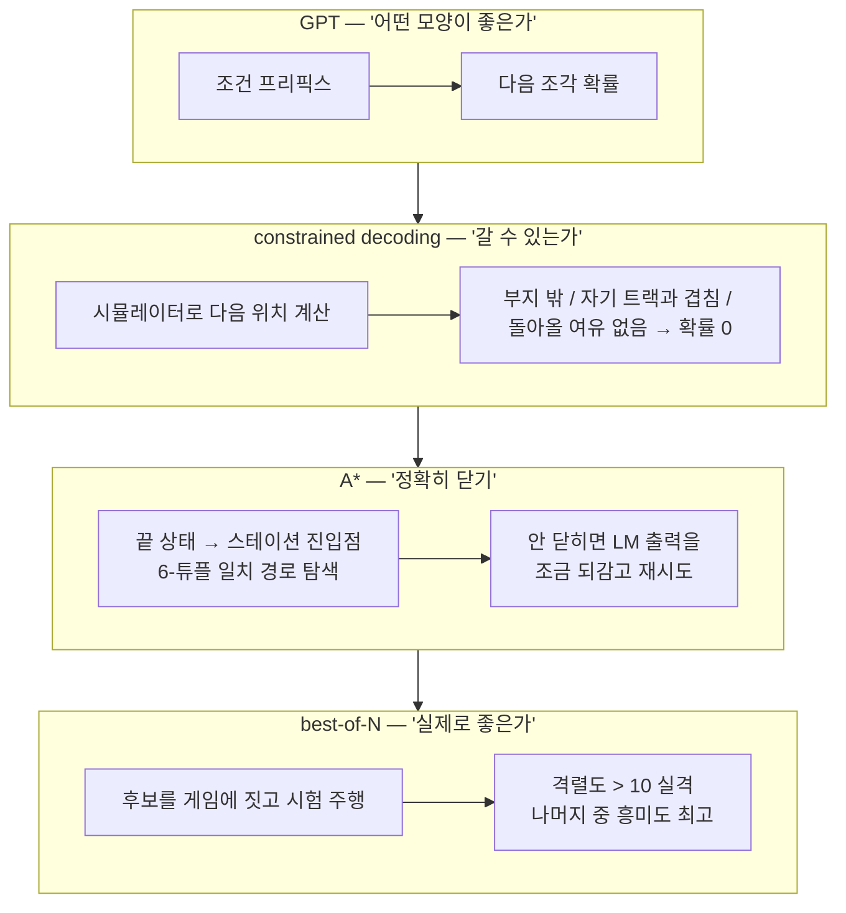
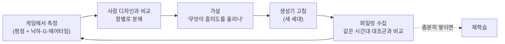
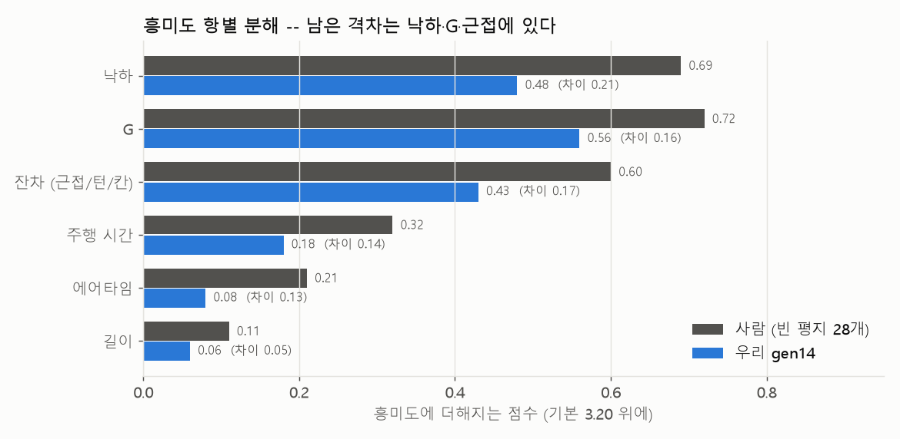

# 모델은 어떻게 학습했고, 어떻게 나아지고 있나

이 문서는 "버튼을 누르면 코스터가 나온다"의 뒤쪽을 설명한다.
무엇을 학습시켰는지, 왜 그렇게 나눴는지, 그리고 매 세대 무엇을 보고 고쳤는지.

- [1. 한 장 요약](#1-한-장-요약)
- [2. 왜 작은 모델로 충분한가](#2-왜-작은-모델로-충분한가)
- [3. 데이터: 게임을 라벨러로 쓴다](#3-데이터-게임을-라벨러로-쓴다)
- [4. 트랙을 문장으로 바꾸기 (토큰화)](#4-트랙을-문장으로-바꾸기-토큰화)
- [5. 모델과 학습](#5-모델과-학습)
- [6. 추론: 모델이 못 하는 건 시키지 않는다](#6-추론-모델이-못-하는-건-시키지-않는다)
- [7. 어떻게 나아지고 있나](#7-어떻게-나아지고-있나)
- [8. 지금의 한계와 다음 단계](#8-지금의-한계와-다음-단계)

---

## 1. 한 장 요약



핵심 아이디어 세 개:

1. **게임을 라벨러로 쓴다.** 사람이 만든 우든 코스터는 수천 개뿐이다. 대신 절차적 생성기로 트랙을 대량으로 만들고,
   OpenRCT2 가 직접 시험 주행해서 평점을 매기게 한다.
2. **평점을 조건으로 넣는다 (Decision Transformer).** "이 트랙은 흥미 6.2 / 격렬 7.9 를 받았다"를 트랙 앞에 붙여 학습하면,
   추론 때 원하는 평점을 넣어서 그런 트랙을 뽑을 수 있다.
3. **기하는 학습시키지 않는다.** 부지 경계, 자기충돌, 폐곡선은 계산으로 강제한다. 모델은 "모양"만 맡는다.

## 2. 왜 작은 모델인가

| | 자연어 LLM | 이 프로젝트 |
|---|---|---|
| 어휘 | 수만~수십만 | **85** (특수 4 + 조건 49 + 조각 32) |
| 시퀀스 길이 | 수천~수십만 | **20~140 조각** (중앙 47~77) |
| 데이터 | 조 단위 토큰 | 약 1천만 토큰 |
| 모델 | 수십억~ 파라미터 | **4.8M** (6층 × 256) |
| 학습 | GPU 클러스터 수 주 | **RTX 5070 1~2분** |

트랙은 "Up25 다음엔 Up25 나 Up25ToFlat 이 온다" 같은 **지역 규칙**이 대부분이라, nanoGPT 급이면 충분하다.
실제로 모델을 12배 키워도 val 손실은 8% 밖에 안 줄었다 (아래 [5절](#5-모델과-학습)).

## 3. 데이터: 게임을 라벨러로 쓴다

### 3-1. 수집 루프



- **설계는 전부 파이썬에서 끝낸다.** 게임 안에서 조각을 하나씩 놓아보면 트랙당 33초가 걸리고 폐곡선은 0% 였다.
  `geometry.json`(게임에서 뽑은 조각 연결 규칙 676개)으로 오프라인 시뮬레이션을 하니 실패한 설계에는 게임 왕복이 없다.
- **인스턴스 16개 병렬.** 이 PC 의 논리 코어가 16개라 거기까지 선형으로 늘고, 25개면 인스턴스당 처리량이 정확히 반토막 난다.
  지금 생성기(gen14)로 **시간당 약 2,000개**.
- **같은 트랙은 같은 평점.** 재측정 3회 전부 동일했고, 평점은 8배속에서 0.6초면 나온다. 위치(x,y)는 영향이 없다.

### 3-2. 생성기가 만드는 골격



생성기는 버전(세대)이 14번 바뀌었다. 세대마다 무엇을 바꿨는지는 [DEVLOG.md](DEVLOG.md) 에 있다.
아래 그림이 그 차이를 한 번에 보여준다 — 같은 "평범한" 트랙이라도 골격이 다르다.



gen5 는 리프트를 올라가 한 번 내려오면 끝이다 (낙하 3회). gen14 는 첫 낙하 뒤에도 언덕을 계속 넘는다 (낙하 6회, 에어타임 4배).
OpenRCT2 흥미도 공식에서 **낙하 횟수(9회까지)와 에어타임이 직접 점수**이기 때문이다 ([7절](#7-어떻게-나아지고-있나)).

### 3-3. 세대 태깅

생성기를 고치면 같은 설정이라도 분포가 바뀐다. 그래서 레코드마다 생성기 세대(`meta.gen_label`)를 붙이고
`build_dataset.py --min-gen gen2` 로 합친다 (중복 제거 포함). 이 덕분에 학습 때 "어느 세대를 얼마나 섞을지"를 고를 수 있다.

## 4. 트랙을 문장으로 바꾸기 (토큰화)

한 레코드가 한 문장이 된다. 실제 데이터 하나 (gen14, 흥미 6.18 / 격렬 7.93):

```
<bos>
<exc=3> <int=4> <nau=4> <latg=4> <width=6> <depth=6> <height=4> <station=1>     ← 조건 (게임이 매긴 실제 평점을 버킷으로)
<sep>
FlatToUp25+chain Up25+chain Up25+chain … Up25ToFlat+chain                        ← 체인 리프트
FlatToDown25 Down25 Down25 … Down25ToFlat                                        ← 첫 낙하
FlatToUp25 Up25 Up25 Up25 Up25ToFlat FlatToDown25 Down25 … Down25ToFlat          ← 둔덕
LeftQuarterTurn3 FlatToRightBank RightBankToFlat Flat FlatToUp25 Up25ToFlat …    ← 본체
<eos>
```

**조건 토큰은 연속값을 버킷으로 자른 것이다** (`model/tokenizer.py` 의 `COND_SPECS`):

| 조건 | 버킷 경계 |
|---|---|
| 흥미도 `exc` | 0 / 0.8 / 1.6 / 3.0 / ∞ |
| 격렬도 `int` | 0 / 1.0 / 2.2 / 4.5 / 7.0 / **10.0** / ∞ |
| 멀미도 `nau` | 0 / 0.6 / 1.2 / 2.2 / 3.0 / 4.7 / ∞ |
| 좌우G `latg` | 0 / 1.4 / 1.8 / 2.1 / 2.35 / 2.6 / 2.85 / ∞ |
| 부지 가로·세로 | 0 / 8 / 12 / 16 / 20 / 24 / 32 / ∞ |

격렬도 10 에 경계를 둔 건 그 위로는 손님이 안 타기 때문이다.
경계는 실제 수집 분포를 보고 잘랐다 — 처음에 촘촘하게 잘랐더니 11개 중 7개 버킷이 비어서 조건 노릇을 못 했다.

**조각 어휘는 32종**이다 (경사·60도·턴·뱅크·체인·브레이크). 새 조각은 반드시 **어휘 맨 뒤에만 붙인다**.
브레이크를 중간에 끼웠다가 기존 체크포인트의 체인 토큰 ID 가 한 칸씩 밀린 적이 있다.

## 5. 모델과 학습

### 5-1. 구조



nanoGPT 와 같은 decoder-only 트랜스포머다 (`model/gpt.py`). 기본 설정 6층 × 256차원 × 8헤드, 컨텍스트 128 토큰, **4.8M 파라미터**.

### 5-2. 무엇을 맞추게 하는가 — 손실은 `<sep>` 뒤에만

```
입력:  <bos> <exc=3> <int=4> … <station=1> <sep> FlatToUp25+chain Up25+chain …
정답:    ×      ×       ×    …      ×       FlatToUp25+chain Up25+chain Up25+chain … <eos>
                └──────── 손실 없음 ────────┘└──────────── 여기만 맞춘다 ────────────┘
```

조건 프리픽스는 "주어지는 입력"이지 맞힐 답이 아니다. 여기에 손실을 걸면 모델이 조건의 분포를 외우는 데 용량을 쓴다 (`model/data.py`).

### 5-3. 학습 설정 (`scripts/04_train.py`)

| 항목 | 값 |
|---|---|
| 데이터 | `dataset.jsonl` 중 gen2 이후, val 5% 분리 |
| 옵티마이저 | AdamW, β = (0.9, 0.95), weight decay 0.1 |
| 학습률 | 3e-4, 워밍업 100 스텝 후 코사인 감쇠 |
| 배치 / 스텝 | 64 / 4,000 |
| 기타 | gradient clip 1.0, dropout 0.1, val 최저일 때만 저장 |
| 시간 | RTX 5070 에서 1.2분 |

### 5-4. 크기를 키워보면



파라미터를 3.2M → 37.9M 로 12배 키워도 val 손실은 0.600 → 0.553, **8% 개선**이다.
그리고 val 손실이 낮아진다고 게임에서 더 좋은 트랙이 나오는 것도 아니었다 (그 비교는 처음에 잘못된 점수로 해서
결론이 뒤집혔다 — [DEVLOG](DEVLOG.md#2026-09-13--재학습-비교가-틀린-목적함수였다)).
**병목은 모델 크기가 아니라 데이터에 어떤 트랙이 들어 있느냐다.** 그래서 지금까지의 개선은 대부분 생성기 쪽에서 났다.

## 6. 추론: 모델이 못 하는 건 시키지 않는다

모델을 그냥 샘플링하면 이렇게 된다 (후보 64개, 실측):

| 항목 | LM 단독 | 왜 |
|---|---|---|
| 조각 연결 규칙 | **100%** | 직전 조각만 보면 되는 지역 규칙 → 잘 배운다 |
| 부지 안에 들어감 | **20%** | 처음부터 지금까지 좌표를 누적해야 한다 → 못 배운다 |
| 폐곡선 (스테이션으로 복귀) | **0%** | x, y, z, 방향, 경사, 뱅크 6개가 동시에 맞아야 한다 |

트랜스포머가 토큰열에서 좌표를 적분해내길 바라는 대신, 역할을 나눴다:



| 단계 | 효과 | 코드 |
|---|---|---|
| 마스킹 | 부지 준수 20% → **100%** | `model/constrain.py` |
| A\* 마무리 | 폐곡선 0% → **100%** | `model/hybrid.py`, `geom/planner.py` |
| 실측 footprint + 입구/출구 예약 | 게임의 배치 거부 16.7% → **4.2%** | `footprints.json`, `geom/simulator.py` |
| best-of-N | "격렬도 10 이하 중 흥미도 최고" | `model/bestof.py` |

요청값이 데이터에 없는 구간이면 (예: 격렬도 4.5 는 수집물에 한 번도 없다) 가까운 도달 가능 값으로 당기고 UI 에 알린다
(`tokenizer.snap()`, 데모 영상의 "exc 7 는 만들 수 없어 6 으로 맞췄습니다").

## 7. 어떻게 나아지고 있나

### 7-1. 개선 루프

모델을 키우는 대신 이 루프를 돌았다:



### 7-2. 세대별 결과


- **gen2~5 → gen6: 쓸 만한 비율 16~23% → 95%.** OpenRCT2 는 우든 코스터가 네 가지 요건(주행 길이 370m, 최고 낙하 12, 음의 G, 낙하 2회)
  중 하나라도 못 채우면 평점을 **반으로 깎는다**. 데이터의 75% 가 그랬다. 이 요건이 시퀀스만으로 100% 예측된다는 걸 알아내서
  설계 단계에서 걸렀다.
- **gen7~12: 정체.** 언덕 흩뿌리기, 막다른 길 회피, 층 쌓기, 60도 경사, 열차 칸 수… 하나씩 넣어봤지만 중앙값은 5.2~5.3 에 머물렀다.
- **gen13~14: 5.25 → 5.51, 최고 6.43.** OpenRCT2 소스의 평점 공식 원문을 찾아서 옮겼더니, 그동안 "제일 강한 레버"라 믿었던 길이는
  813m 여도 +0.11 밖에 안 되는 항이었다. 진짜 레버는 **낙하 횟수(9회 상한)와 에어타임**. 첫 낙하 뒤에 둔덕을 연달아 붙이자 공식대로 움직였다.

### 7-3. 남은 격차



같은 빈 평지에 지어서 잰 사람 디자인(중앙 6.35)과 gen14 의 차이를 항별로 쪼갠 것이다 (`scripts/16_rating_breakdown.py`).
낙하 0.21, 근접 등 잔차 0.17, G 0.16, 주행 시간 0.14, 에어타임 0.13 — 다음 세대의 목표가 여기서 나온다.

### 7-4. 측정 도구부터 의심하기

이 프로젝트의 큰 진전 상당수는 "측정이 틀렸다"를 발견한 순간에 났다:

| 무엇이 틀렸나 | 영향 |
|---|---|
| best-of-N 점수가 "요청값과의 거리"였다 | 흥미도를 더 낸 모델이 감점돼 "재학습 실패"라는 결론이 두 번 났다 |
| TD6 헤더 평점을 한 칸 밀려 읽었다 | "사람 흥미도 7.90" 은 사실 격렬도였다. 진짜 격차는 2점이 아니라 1.2점 |
| 언덕 여유를 오프라인 길이로만 검증했다 | 열차가 골짜기에서 영원히 왕복 → 수집 시도의 76% 가 조용히 버려졌다 |

자세한 경위는 [DEVLOG.md](DEVLOG.md).

## 8. 지금의 한계와 다음 단계

- **배포된 체크포인트(`model/ckpt.pt`)는 초기 데이터 33,171개로 학습한 것이다.** 데모 영상도 이 모델이다.
  gen14 가 시간당 2,000개씩 쌓이고 있으니, gen14 비중을 높인 재학습을 **best-of-N 흥미도(격렬도 ≤ 10)** 로,
  시드 여러 개로 비교하는 게 다음 일이다.
- **흥미도 버킷의 최상단이 3.0 이상이다.** gen6 이후 쓸 만한 트랙은 전부 같은 `<exc=3>` 에 들어가서,
  흥미 5.2 와 6.4 를 조건으로 구분할 수 없다. 재학습 전에 버킷을 다시 잘라야 한다.
- **컨텍스트 128 토큰.** 사람 디자인(중앙 127조각)은 학습에서 조용히 빠진다. 스톡 디자인으로 스타일 파인튜닝을 하려면 `--block-size 256`.
- **격렬도 10 제한이 이제 실제로 걸린다.** 낙하를 늘리자 격렬도 10 이하 비율이 95% → 84% 로 내려왔다. best-of-N 에서 걸러지니 당장 문제는 아니다.
- **환경 몫 약 0.7.** 같은 사람 디자인이 원래 공원(터널·주경)에서는 빈 평지보다 0.7 높게 나온다. 유저 공원에 지을 때 쓸 수 있는 별도 레버로 남아 있다.

그림은 `python scripts/19_doc_figures.py` 로 다시 그릴 수 있다.
